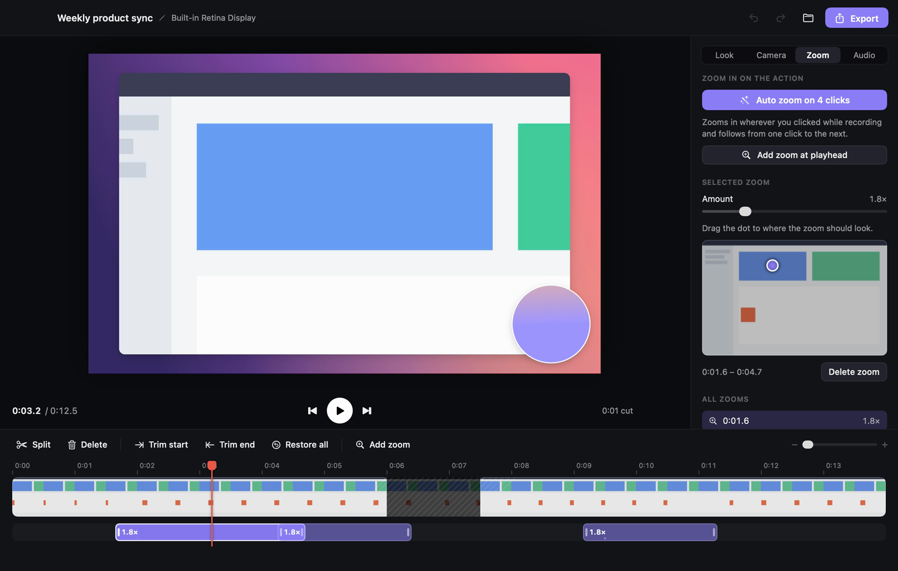
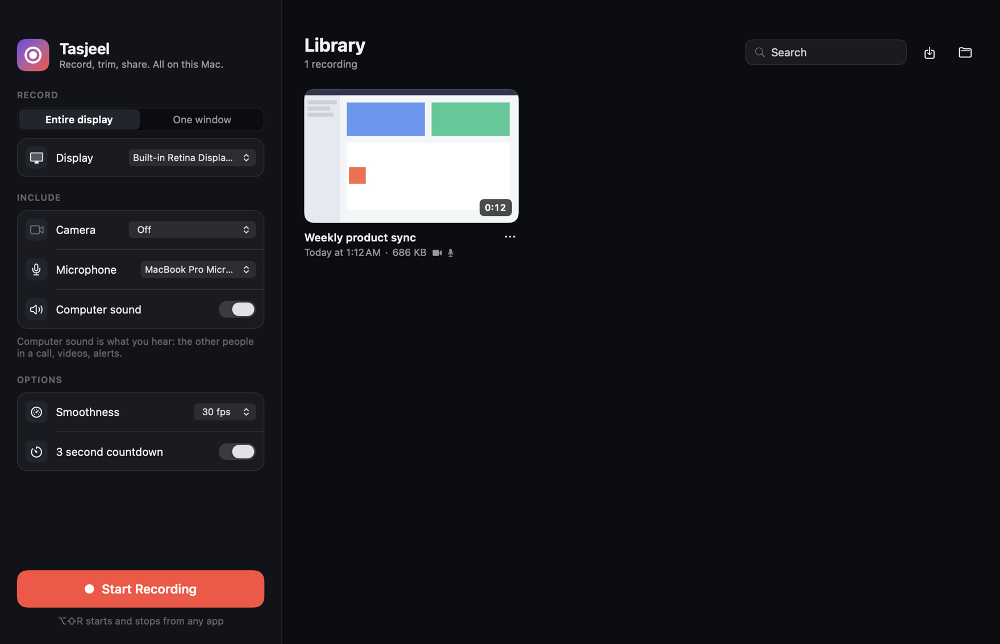

# Tasjeel

A screen recorder and video editor for the Mac that keeps everything on your machine. Record a meeting or a walkthrough with your screen, voice, the computer's sound and your webcam, then trim it, frame it and export an MP4. No account, no upload, no subscription.

*Tasjeel* (تسجيل) is Arabic for "recording".





<sub>Screenshots show generated sample footage.</sub>

## What it does

**Record**

- An entire display or a single window, at the display's full Retina resolution, 30 or 60 fps
- Encoded to a fixed picture quality rather than a fixed data rate, so text is sharp on the very first frame after the screen changes, and a still screen costs almost no disk space
- Your microphone and the computer's sound (the other side of a call) on **separate audio tracks**
- Your webcam, saved as its own file so you can move, resize or hide yourself afterwards
- Pause and resume; the paused stretch never reaches the file
- Start and stop from any app with **⌥⇧R**, from the menu bar, or from the floating control pill
- The floating controls and camera bubble are left out of display recordings
- Written to disk in fragments every few seconds, so a crash costs seconds, not the meeting

**Edit**

- Split, delete and trim on a timeline; every cut can be restored, and undo goes back 200 steps
- *Studio* look: wallpaper, padding, rounded corners and a drop shadow, or keep it *Plain*
- Canvas shapes for any destination: source, 16:9, 4:3, 1:1, 9:16
- Camera overlay as a circle, square or wide tile in any corner, mirrored or not
- **Auto zoom**: mouse clicks are logged while recording, and one button turns them into smooth zooms that pan from click to click. Add, move, resize and aim zooms by hand too
- Separate volume for your voice and the computer's sound
- Import any existing video file and edit it the same way

**Transcribe** (macOS 26 or later)

- One button turns the talking into a transcript, using the speech models built into macOS. The audio never leaves your Mac
- Lines are marked **You** or **Others**, because your microphone and the computer's sound were recorded separately
- Search the transcript and click any line to jump to that moment
- Show the transcript as captions on the video, in the preview and in the export
- Save it as a text file or as `.srt` subtitles; both follow your cuts
- Over 50 languages, Arabic among them. macOS downloads a language's model the first time you use it

**AI notes** (optional)

- One button turns the transcript into a title, a summary, key points, decisions, action items and chapters
- Chapters appear along the top of the timeline; click one to jump there. Copy them as a `0:00 Title` list for a video description
- You choose what does the writing: the model built into macOS, a model you download into [Ollama](https://ollama.com), or Claude with your own Anthropic API key
- Private by default: the first two run on your Mac, and "Automatic" never uses the cloud. Claude is used only if you pick it and add a key, and then only the transcript text is sent, never audio or video
- Copy the notes or save them as Markdown; chapter times follow your cuts

**Polish with AI: Remotion export** (optional, needs Node.js)

- Saves the finished video as a [Remotion](https://www.remotion.dev) project: a folder of code that plays it with animated, word-highlighted captions, chapter cards, a title card and a progress bar
- Open that folder in Claude Code or another AI coding agent and describe the look you want. The project carries a guide for agents, and its **Start** script installs Remotion's official agent skills
- Double-click **Start** to preview and **Render** to produce the video. No terminal needed
- Exporting again refreshes the video and its data and keeps your changes to the code
- Works right to left for Arabic

**Studio: marketing videos from a chat** (optional, needs Node.js and Claude or Ollama)

- Say what the video is for, add screenshots, a logo or recordings, and an AI model writes the video scene by scene. Ask for changes until it is right
- Watch it inside the app in wide, square and tall; every earlier version can be brought back
- Claude (your own API key) sees the pictures you add; a model in Ollama keeps everything on your Mac
- The model may use only what you gave it and may not invent quotes or figures, and every storyboard is checked before it is used
- How it works and what is sent where: [docs/studio.md](docs/studio.md)

**Marketing videos from a storyboard file** (optional, needs Node.js)

- Or write the list of scenes yourself and Tasjeel builds it: **File › New Video from Storyboard File…**
- Six kinds of scene: an opening line, a piece of a recording, a feature with points, a customer quote, figures that count up, and a closing call to action
- One brand kit (logo, colours, font) applies to every scene
- Renders wide (16:9), square and tall (9:16) from the same storyboard, left to right or right to left
- Mistakes in the storyboard are listed all at once, in plain words
- The format and an example: [docs/storyboard.md](docs/storyboard.md)

**Export**

- MP4 in H.264 or HEVC, at the recording's own resolution by default (up to 4K) or scaled down to 1440p, 1080p or 720p, at 30 or 60 fps
- What you see in the preview is exactly what is exported: both go through the same renderer, and the preview is drawn at the exact pixel size it is shown at
- Colours come out as they were on screen

## Requirements

- macOS 15 (Sequoia) or later; transcripts need macOS 26. Built and tested on Apple silicon with macOS 26
- Xcode 26 or later to build

## Install

```bash
git clone https://github.com/rnl180/tasjeel.git
cd tasjeel
scripts/build-app.sh --install
```

That builds `dist/Tasjeel.app` and copies it to `/Applications`. Leave out `--install` to only build.

The script signs the app with your Apple Development certificate if you have one, which lets macOS remember the app's permissions across rebuilds. Without one the app is ad-hoc signed and still works; macOS just asks for permissions again after each rebuild.

## First run

macOS asks for three permissions, each the first time it is needed:

| Permission | Why | Where |
| --- | --- | --- |
| Screen & System Audio Recording | Capturing the screen and the computer's sound | System Settings › Privacy & Security. macOS asks you to reopen the app afterwards |
| Microphone | Your voice | Prompt on first recording |
| Camera | Your webcam, only if you pick one | Prompt on first recording |

## Using it

1. Choose **Entire display** or **One window**, and which camera, microphone and computer sound to include.
2. Press **Start Recording** (or ⌥⇧R). After a 3 second countdown the window gets out of the way and a small control pill appears.
3. Press **Stop** (or ⌥⇧R again). The recording opens in the editor.
4. Cut what you do not need, pick a look, and press **Export**.

### Editor shortcuts

| Key | Action |
| --- | --- |
| Space | Play / pause |
| S | Split at the playhead |
| Delete | Remove the selected part or zoom |
| [ and ] | Trim everything before / after the playhead |
| Z | Add a zoom at the playhead |
| ← → | Step one frame |
| ⌘Z, ⇧⌘Z | Undo, redo |

## Where your recordings live

Everything is in `~/Movies/Tasjeel`, one folder per recording:

```
~/Movies/Tasjeel/2026-11-16 09.30.12/
    project.json   title, cuts, look, zooms, click log
    screen.mov     screen (HEVC) + computer sound + microphone
    camera.mov     webcam (when one was recorded)
    thumb.jpg
    transcript.json   the transcript, once you create one
    notes.json        AI notes and chapters, once you create them
```

The `.mov` files are ordinary QuickTime movies you can open in any player. Editing never changes them; the edit is only a description in `project.json`. Deleting a recording in the app moves its folder to the Trash.

## How it is built

A Swift package with two targets and no third-party dependencies:

- **TasjeelCore**: the engine. ScreenCaptureKit for screen, system audio and microphone; AVFoundation for the camera, writing and export; Core Image on Metal for compositing.
- **Tasjeel**: the SwiftUI app.

| File | Role |
| --- | --- |
| `ScreenRecorder.swift` | Configures the ScreenCaptureKit stream and passes samples on |
| `CaptureWriter.swift` | Turns samples into a movie file: timestamps, pausing, one audio track per source |
| `CameraController.swift` | Runs the webcam for the live bubble and its own movie file |
| `RecordingClock.swift` | One clock for both files, so pauses and camera sync line up |
| `RecordingSession.swift` | One recording from start to finish, including the click log |
| `FrameRenderer.swift` | Draws a finished frame: wallpaper, zoomed screen, camera overlay. Resizes with a Lanczos filter so text stays crisp |
| `StudioCompositor.swift` | Plugs the renderer into AVFoundation for playback and export, in the colour space the recording uses |
| `CompositionBuilder.swift` | Turns the cut list into a playable composition |
| `Timing.swift` | Maps between recording time and edited time; zoom easing; auto zoom |
| `Transcriber.swift` | Runs each audio track through macOS's on-device speech models |
| `Transcript.swift` | Transcript lines: splitting into readable lines, echo removal, text and SRT export |
| `CaptionRenderer.swift` | Draws a caption line, including right-to-left text |
| `NotesGenerator.swift` | Writes notes from a transcript with any model: the prompt, long meetings in parts, reading the answer |
| `AIEngines.swift` | The three models (Apple, Ollama, Claude) and the rule for choosing between them |
| `MeetingNotes.swift` | Notes and chapters, re-timing chapters after cuts, Markdown export |
| `RemotionProject.swift` | Writes a recording out as a Remotion project |
| `Storyboard.swift` | Checks a storyboard and fills in its defaults |
| `StudioProject.swift` | Builds a video project from a storyboard, trimming clips to what each scene uses |
| `StudioWorkspace.swift` | A Studio project on disk: chat, materials, and the small pictures shown to a model |
| `StoryboardWriter.swift` | Turns a chat into a checked storyboard: the instructions, reading the answer, sending faults back |
| `StudioRenderer.swift` | Finds Node.js, keeps one shared copy of Remotion, and renders a size |
| `RemotionTemplate.swift` | Both projects' files, generated from the folders in `Templates` |

### Development

```bash
swift build          # debug build
swift test           # engine tests
```

The tests generate their own footage and run the real pipeline: they write movies through `CaptureWriter` (including a pause), render frames and read pixels back, and export an edited video and inspect the result.

A few aids for working on the app, none of which are needed for normal use:

- `TASJEEL_LIBRARY=/some/folder` makes the app use that folder instead of `~/Movies/Tasjeel`.
- `Tasjeel --selftest-record 3` records the main display for three seconds with no UI and prints what was written.
- `Tasjeel --transcribe <recording folder> --language en-US` transcribes a recording and prints the lines.
- `Tasjeel --notes <recording folder> --engine ollama` writes AI notes from a saved transcript and prints them. `TASJEEL_OLLAMA_URL` points the app at an Ollama on another address.
- `Tasjeel --remotion <recording folder> --out <project folder>` exports a Remotion project.
- `Tasjeel --storyboard Examples/studio/storyboard.json --out <project folder>` builds a video project from a storyboard.
- `Tasjeel --studio <project folder> --add shot.png --say "A launch video for…" --engine ollama --render wide` runs one turn of the Studio: adds material, asks the model, saves the storyboard, renders a size. With `--engine claude` the key is read from `ANTHROPIC_API_KEY`. `TASJEEL_STUDIO=/some/folder` moves the Studio's projects there.
- `Tasjeel --render <recording folder> --out out.mp4` exports a recording with its saved edit. Add `--frame 6` and a `.png` name to write one finished frame instead, which is the quickest way to check sharpness and colour.
- `TASJEEL_SNAPSHOT=/some/folder` makes the app save pictures of its own windows there and quit (see `DebugSnapshot.swift`).

### About transcripts

- Two speech engines ship with macOS 26. Tasjeel uses the newer long-form one where it knows the language (30 locales: English, Spanish, French, German, Italian, Portuguese, Japanese, Korean, Chinese) and the dictation engine for the rest (Arabic, Turkish, Hindi, Russian and others). The dictation engine does not add punctuation in every language.
- Without headphones, your microphone also hears the call coming out of the speakers. Tasjeel drops microphone lines that repeat what the other side said at the same moment, but headphones give the cleanest You / Others split.
- Accuracy depends on Apple's models and on the audio. The transcript is not editable yet.

### About the Remotion export

- The templates live in `Templates/remotion` (a recording) and `Templates/studio` (a storyboard) as ordinary files, so they can be opened and run with Remotion. After changing one, run `scripts/embed-remotion-template.py`, which copies them into `RemotionTemplate.swift`; a test fails if they differ.
- To check a template change for real: `Tasjeel --remotion <recording> --out /tmp/project`, then in that folder `npm install`, `npm run typecheck` and `npm run render`.
- The project is pinned to one Remotion version (all Remotion packages must match). `npx remotion upgrade` moves it forward.
- Tasjeel hands Remotion an H.264 MP4 with the cuts, zooms, wallpaper and camera already applied, because the video component Remotion recommends does not play HEVC. Captions are not burned in; Remotion draws them from `src/recording.json`.
- Remotion is free for individuals and small teams; larger companies need a licence from Remotion.

### About AI notes

- **Your API key is never in this repository or in any file.** You paste it into AI settings and it is stored in the macOS Keychain. Remove it there at any time.
- Claude requests go straight from your Mac to `api.anthropic.com` using `claude-opus-5-5`, and Anthropic bills your key. If a safety check declines a request, the API is asked to retry on the fallback model Anthropic recommends (`fallbacks: "default"`).
- The model built into macOS needs Apple Intelligence switched on, knows fewer languages (no Arabic at the time of writing) and reads only a few pages at a time, so long meetings are summarised in parts.
- For Ollama, AI settings offers to download `gemma4:12b` (about 8 GB), which handles many languages. Any model you already have works too.
- Notes are written from the transcript, so a misheard word can end up in them. Treat them as a draft.
- The Studio uses the same key and the same model. It sends more than the notes do (your chat and small copies of the pictures you add); [docs/studio.md](docs/studio.md) lists exactly what.
- The tests cover this with a scripted model and local stand-in servers. No real model runs in the test suite.

## Not there yet

- Editing the transcript, and cutting the video by deleting text
- Asking questions about a recording, and letting the AI make the cuts
- Voiceover and music in Studio videos, and publishing them
- Recording a connected iPhone or iPad
- GIF export
- Cursor smoothing and click highlights
- Recording only a selected region of the screen

## Plans

- [Marketing Video Studio](docs/plans/marketing-video-studio.md): describe a video in a chat, add your material, and get a finished marketing video with voiceover and versions for each social network. Two of five phases are built (storyboards and the Studio chat, above); voiceover, music and publishing are still proposals.

## License

MIT. See [LICENSE](LICENSE).
